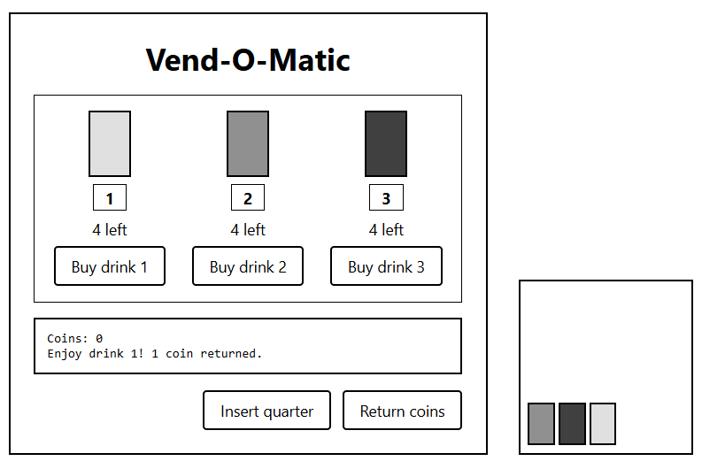

# Vend-O-Matic

HTTP API for a beverage vending machine. Only accepts quarters (if I refer to a coin, it's inherently going to be a quarter), and each drink costs 2 quarters. Can insert 1 coin at a time. 3 different drinks with 5 in stock available for purchase. Can accept more than 2 quarters, but only allows purchase of 1 drink per transaction, so only 1 drink will be dispensed. Once transaction is completed, machine will return unused coins.
Built with Python 3.12+ with Django framework.

## Requirements

- Python 3.12 or newer. Check with `python3 --version`
- To install or update: download from python.org, or `brew install python`

## Setup (macOS)

```bash
git clone https://github.com/judeottilie-tech/emma-o-matic
cd emma-o-matic
python3 -m venv venv
source venv/bin/activate
pip install -r requirements.txt
```
Developed on Windows with Git Bash. On Windows, activate with `source venv/Scripts/activate` (line 4 above)


## Run the server

```bash
python manage.py runserver
```

The API runs at http://localhost:8000

## Run the tests
(server doesn't have to be running)

```bash
python manage.py test
```

## Try it with curl

```bash
# See inventory
curl -i localhost:8000/inventory

# Insert 2 coins
curl -i -X PUT localhost:8000/ -H "Content-Type: application/json" -d '{"coin": 1}'
curl -i -X PUT localhost:8000/ -H "Content-Type: application/json" -d '{"coin": 1}'

# Buy drink 1
curl -i -X PUT localhost:8000/inventory/1

# Check drink 1 (now has inventory stock of 4)
curl -i localhost:8000/inventory/1

# Insert coin, get it back
curl -i -X PUT localhost:8000/ -H "Content-Type: application/json" -d '{"coin": 1}'
curl -i -X DELETE localhost:8000/
```

`-i` shows the response headers (X-Coins, X-Inventory-Remaining).

## Try it in the browser

While the server is running, open http://localhost:8000/machine

The buttons call the same API as the curl commands above, so you can see visually what each request does.


## Notes on design choices
- Ids are 1-based, I feel it works better for real world application. In Python, lists will accept a negative index, so id 0 would turn into index -1 and sell drink 3. I made sure to test for item_id < 1 to check for this potential bug.
- Stock is checked before coins.
- Resets on restart, state is in memory. If server is restarted, the memory will restart. 
- I wanted to do a very basic front end to visually show what was happening in the app. It can be seen through the tests, but I personally like to be able to see an actual image of what is happening.
- The coin count on the page comes from the server when it loads, so it stays correct after a refresh.


